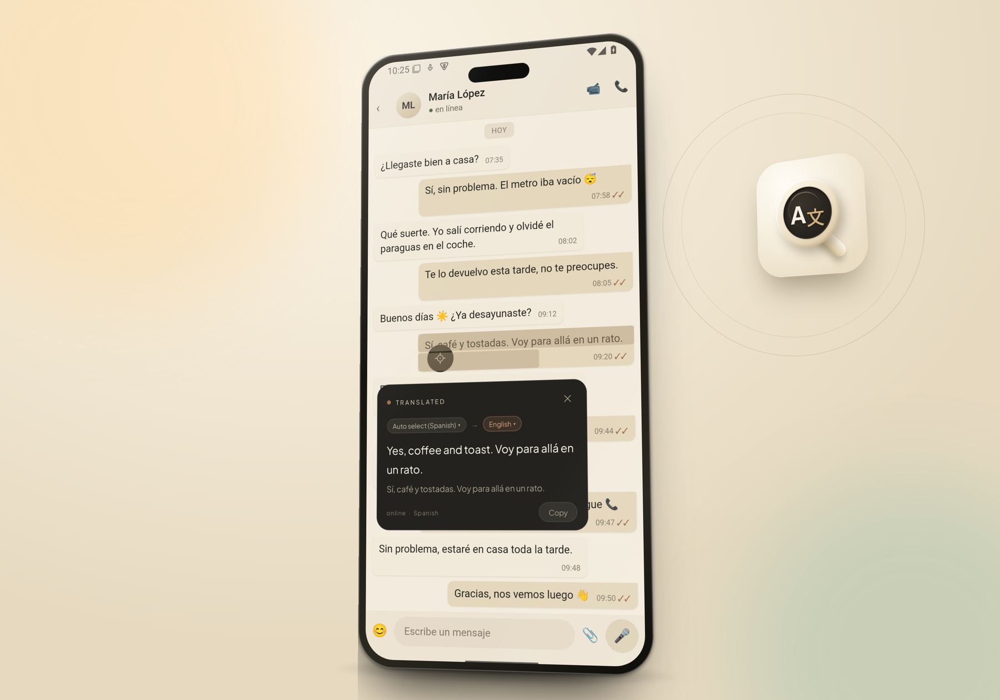
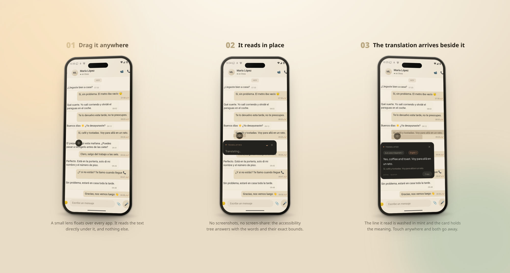
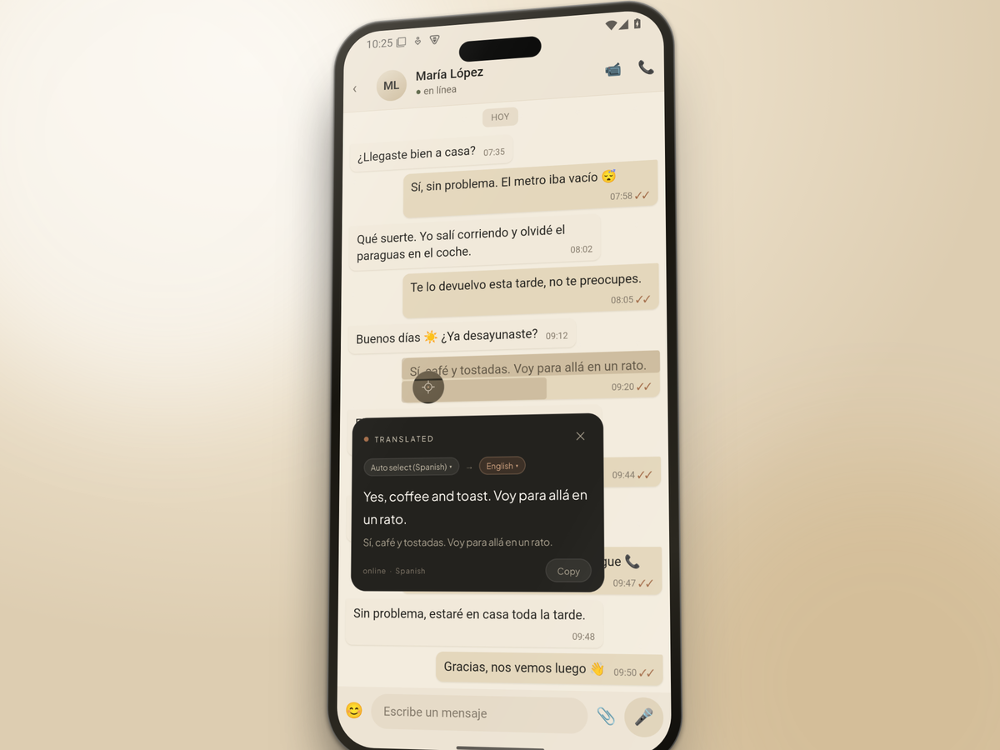
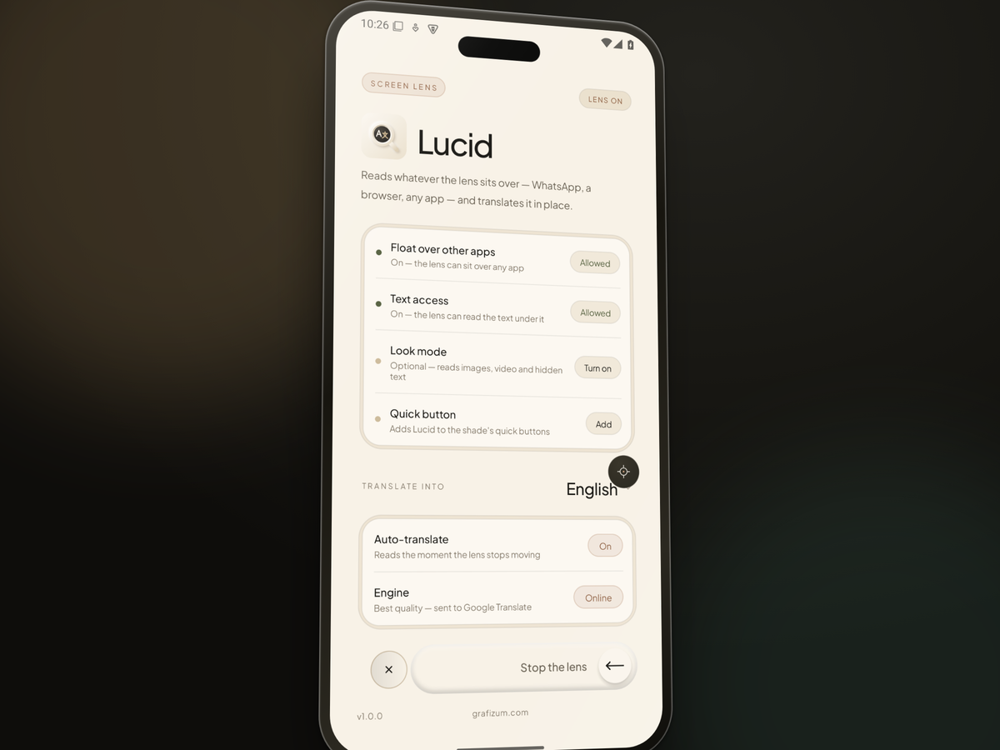
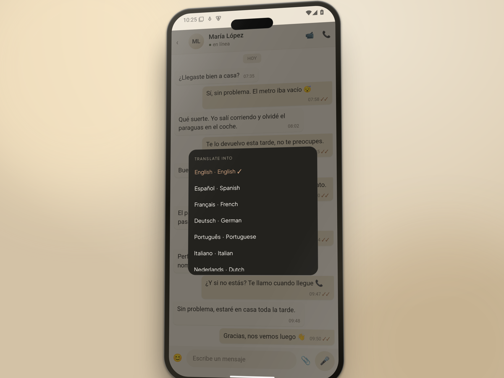
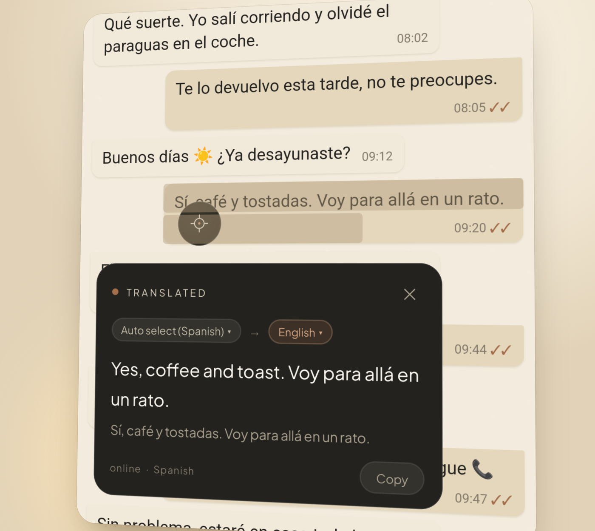
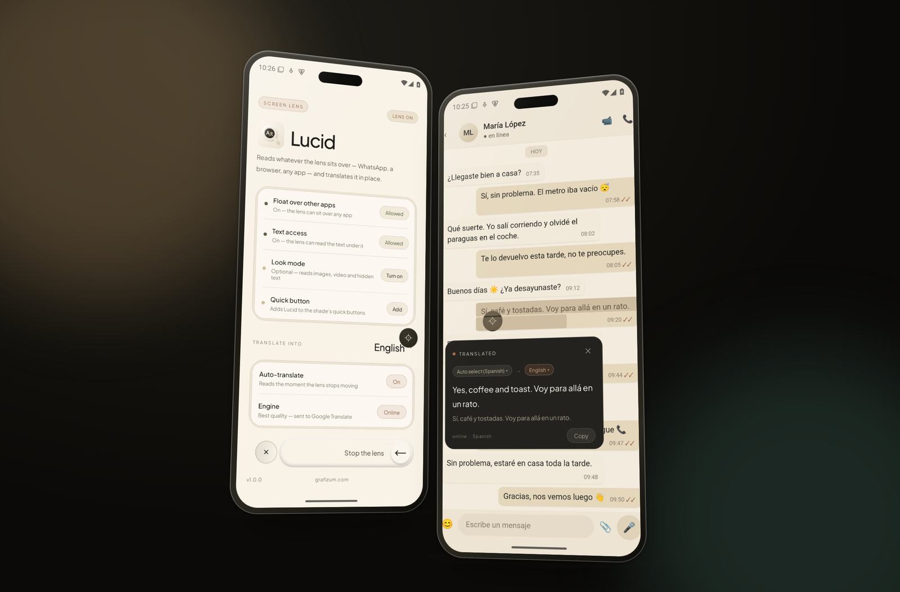

<div align="center">


# Lucid

**An Android screen translator.** A floating lens reads whatever sits under it and translates it in place — in any app, with no screen recording and no per-app setup.

<sub>A <a href="https://github.com/grafizum">Grafizum</a> studio product</sub>

[](https://github.com/grafizum/Lucid/releases/latest)
[](#-install)
[](#-install)
[](#-translation-engine)
[](#-licence)

[Install](#-install) · [Features](#-features) · [Screenshots](#-screenshots) · [How it reads your screen](#-how-it-reads-your-screen) · [Japanese](#-japanese-readings-and-words) · [Build from source](#-build-from-source) · [Limits](#-limits-worth-knowing)



</div>

---

> [!NOTE]
> **Status: first release, debug build.** Android 8.0 or newer, arm64 and x86_64. It is verified on an Android 15 emulator and installs on a Galaxy S22+; some manufacturers kill accessibility services aggressively, and Look mode still asks Android to share the screen each session.

Lucid is not a split-screen translator and not a screenshot tool. It is a small glass lens that floats over every app: drag it like a cursor, and the moment it stops it reads the text underneath and puts the translation in a card beside it. Nothing is configured per app, and the card clears itself as soon as you touch anywhere else.

## 🧭 How it works



1. **Drag it anywhere.** A small lens floats over every app — no split screen, no picking an app, no screenshot button. Whatever is under it when you let go is what it reads.
2. **It reads in place.** The words come from Android's accessibility tree, not from the framebuffer: the exact string plus the bounds of every character, which is why the highlight can sit on the glyphs instead of a rectangle around them.
3. **The translation arrives beside it.** The line it read is washed in mint, one band per line, and the card holds the meaning with the language on each side. A press anywhere else takes both away — and the touch still reaches the app underneath.

## ✨ Features

- **Reads the text, not the pixels** — it asks Android's accessibility tree what is at the point under the lens, so the highlight sits exactly on the words and no screen recording is involved.
- **Works over any app** — chat apps, browsers, PDFs, settings, even a game's UI: if the app publishes text, the lens reads it.
- **Translates in place** — the card opens beside the text you pointed at, with the picked line washed in mint, one band per line, ending where the words end.
- **Touch anywhere and it is gone** — the card and the highlight clear together, and the touch still reaches the app underneath. That holds mid-read too: pressing outside drops the read instead of making you wait for an answer you no longer want.
- **Tap for languages** — the lens opens the language list; the pick is saved for everything it reads next. A tap never reads.
- **Long-press to pause** — the lens fades to a ghost until you long-press again.
- **Two engines** — Google's translation service when you have a connection, ML Kit models on-device when you want nothing to leave the phone.
- **Japanese extras** — furigana-style readings above the kanji, and a short word-by-word list under the line.
- **Look mode (optional)** — when a surface has no text in the tree (a photo, a video frame, a game), it can OCR one still frame instead.
- **Quick-settings tile** — start and stop the lens from the shade, without opening the app.

## 📦 Install

Grab **`Lucid-1.0-debug.apk`** from the [latest release](https://github.com/grafizum/Lucid/releases/latest) (67 MB, arm64 + x86_64), open it on the phone, or with a USB cable:

```bash
adb install -r Lucid-1.0-debug.apk
```

It is a debug build, so Android asks you to allow installing from this source the first time. First launch asks for two switches, once:

| Permission | Why Lucid needs it |
| --- | --- |
| **Display over other apps** | So the lens, its card and its highlight can float on top of whatever you are using. |
| **Text access** (Android Accessibility) | So the lens can read the words under it. It applies to the whole phone, not one app. |

Text access is asked in the open, before Android's switch: the sheet says exactly what the lens reads — the words under it, never the rest of the screen, with no copy kept — and that with **ENGINE: Online** those words are sent to Google Translate, along with the rest of that screen as context. You tap **I agree** first; only then does the switch appear. Declining leaves the app usable, and asking again brings the note back.

Then press **Start the lens**.

## 🖼 Screenshots

| The lens on a message — the card holds the translation | The app: permissions, language, engine |
| --- | --- |
|  |  |
| **Tap the lens — the language list, saved for what comes next** | **Long-press — the lens pauses to a ghost until you wake it** |
|  | *A tap opens this list and saves the pick for everything the lens reads next; a long-press parks the lens until you long-press it again.* |

**Closer in** — the wash covers exactly the line that was read, and the card's footer says which engine answered:



**Two surfaces at once** — the app behind, a translated chat in front:



## 🎯 How it reads your screen

Lucid asks Android's accessibility tree "what text is at this point?" instead of taking screenshots:

- **No recording, no screen-share dialog.** Accessibility is granted once in Settings and stays granted; there is no MediaProjection session and no per-app picker.
- **Text, not pixels.** It gets the exact string plus its bounds, so the highlight sits exactly on the text and timestamps and tick marks can be dropped from chats.
- **The wash is cut from the app's own geometry when the app publishes it.** Android lets a service ask a text node where each of its characters sits — the channel TalkBack's magnifier uses — and most native views answer, so the band is exact: gathered into lines, from the first glyph to the last in the run. Chrome answers that request with the whole line's rect for every character, which is not geometry, so that answer is refused and the band is fitted from the node's box instead. Web views publish no type size at all, so on a page whose CSS line height is unusual the band can be a little short or loose — it is never off the run it read.
- **Only the text under the lens.** It takes the single text node the lens is sitting on — a chat bubble, a message, a paragraph — and translates that. If you land in the gap between two lines it looks a few millimetres around the point and takes the nearest text, so the cursor has no dead zones.
- **One language at a time.** A line can mix scripts — "I love 日本語 so much". Only the run under the lens is read: hover the Japanese and the card holds the Japanese, hover the English and it holds the English. Punctuation and spaces bridge two stretches of the same script, so an ordinary sentence still comes through in one piece.
- **Punctuation travels with the text.** The run under the lens keeps the marks that touch it, `？` included: without the mark, `彼は来ます？` reached the engine as a statement; with it the card reads **Will he come?**.
- **The card says which engine ran** — `online` or `on-device` in its footer.

### Translation engine

`ENGINE` in the app picks how text is translated:

| Engine | What it does |
| --- | --- |
| **Online** (default) | Google's translation service. Best quality, especially for Japanese, Chinese and Korean. The text under the lens leaves the phone. |
| **On-device** | ML Kit models, downloaded once and then offline. Nothing leaves the phone, though the smaller models are occasionally clumsy on complex sentences. |

If the online service is unreachable the card says so instead of showing a rough guess.

## 🈁 Japanese: readings and words

When the online engine translates Japanese, the card's original line gains the *reading* of the sentence in small, faint kana, centred over the kanji they belong to — the way a Japanese book prints ruby. `この店はとても良いです。` gets みせ over 店 and よ over 良, and the kanji stay the real text of the line, so it still selects and copies as before.

The engine hands back the reading of the whole sentence in Latin letters (`Kono mise wa totemo yoidesu.`), never which kanji it belongs to. Japanese supplies the missing half: the kana written in the sentence are identical in the reading, in the same order, so they act as anchors — a kanji takes exactly the reading between the kana around it, and kanji with nothing pronounceable between them share one stretch, split in proportion. Where it can be placed honestly, it is; a kanji whose reading cannot be resolved stays bare rather than being guessed at.

The respelling is a conversion, not a dictionary: particles are matched by sound (は is spoken わ) and long vowels spelled out (ō → おう, so 学校 → がっこう). It knows that "nihon" is にほん, never that 日本 is read that way. On-device mode publishes no reading at all, so the card is plain there — this needs **ENGINE: Online**.

Japanese is also written without spaces, so underneath the original the card grows a short list — one word per line, the word in mint, its meaning beside it:

```
日本語        Japanese
勉強しています  I'm studying
```

The split comes from the writing itself, not from a dictionary of the language: a run of kanji takes the kana welded onto it (食べる, 飲みます), a katakana run stands alone (コーヒー), and a kana run that is only a particle (を, が, に) is dropped — as is a particle glued to a noun (東京から is 東京, then a particle). Latin words and digits are left out; they already read as themselves. All the words travel in **one** request, one per line, and the engine hands back one line of meaning each. If that answer does not come back with exactly as many lines as there were words, nothing is drawn: a word is never shown a meaning that belongs to its neighbour. At most ten words are asked about and six are shown.

## 🌏 Changing the language from the card

Both chips in the card are live: tap the target chip (`English ▾`) to translate the same text into another language, or the source chip (`Japanese ▾`, which also offers *Auto detect*) if the language was guessed wrong. The sheet dims the screen and closes itself when you pick.

The change applies to **that card only** — the footer gains a `temporary` marker and the target chip loses its mint fill. Nothing is saved: drag the lens to the next thing and it translates into the language chosen in the app again. For a change that sticks, tap the lens itself — that list saves what you pick — or use `TRANSLATE INTO → Change` in the app.

### Look mode (optional)

Some surfaces (images, games, video, apps that hide their text) have nothing in the accessibility tree. **Look mode** adds a screen-capture fallback: same lens, but it asks for the *whole display* — never a single app — takes one still frame per read, runs OCR on-device, and keeps nothing. It is off by default and only prompted for when you turn it on.

## 🛠 Build from source

Requirements: JDK 17, Android SDK with platform 36 and build-tools 36, and network access for the first Gradle run.

```bash
git clone https://github.com/grafizum/Lucid.git
cd Lucid/android
echo "sdk.dir=$HOME/Android/Sdk" > local.properties   # your SDK path
./gradlew assembleDebug
# -> app/build/outputs/apk/debug/Lucid-v1.0.0-v1-debug.apk
```

Stack: Kotlin, plain Android views (no Compose), an `AccessibilityService` for text, `TYPE_APPLICATION_OVERLAY` windows for the lens, the highlight and the card, ML Kit for translation (and OCR in Look mode), and coroutines for the pipeline.

### Trying it without a chat app

`DemoChatActivity` is a full-screen messaging surface (bundled HTML) for trying the lens without a real chat app:

```bash
adb shell am start -n com.grafizum.lucid/.DemoChatActivity
```

## 📁 Project layout

```
android/                      the app
  app/src/main/java/com/grafizum/lucid/
    MainActivity.kt              permissions + start/stop the lens
    LensService.kt               foreground service: bubble, selection, card, pipeline
    LensAccessibilityService.kt  "what text is at this point?" via the a11y tree
    HighlightView.kt             the mint selection wash, one band per line
    Romaji.kt                    romaji -> hiragana, for the readings
    Furigana.kt                  lines a reading up with the kanji it belongs to
    RubyTextView.kt              keeps room above the line and draws that kana there
    TextLines.kt                 text box -> per-line bands, from the app's
                                 character boxes or a fitted type size
    TextRun.kt                   narrows a mixed-script line to the run under the lens
    SightView.kt                 crop frame for look mode
    ScreenCapturer.kt            MediaProjection -> one cropped still (look mode)
    VisionTranslator.kt          clean-up -> language ID -> translation (OCR in look mode)
    LanguagePicker.kt            target language list
    DemoChatActivity.kt          demo chat surface
  app/src/main/assets/demo-chat.html
site/                         policies site served at lucid.grafizum.com
wrangler.toml                 Worker lucid-legal + the custom domain
desktop/                      earlier desktop prototype (Electron), kept for reference
docs/                         the images in this README
store-listing/                Play Store listing copy and art
```

## ⚠️ Limits worth knowing

- **Android only.** iOS does not allow floating overlays over other apps.
- **Text access needs text.** Chat apps, browsers, settings and most native apps expose it; images, video and some games do not — that is what Look mode is for.
- The APK is a **debug build**: no Play Store signing, no minification.
- Tested on an Android 15 emulator (1080×2400, Pixel 7a profile) and installed on a Galaxy S22+; some manufacturers kill accessibility services aggressively, so if the lens stops reading, check that **Lucid text access** is still switched on.
- Machine translation is good, not perfect: "portería" came back as "goal" in one test instead of "concierge desk".

## 📜 Policies and licence

The Play Store listing needs a public privacy policy, so the app's legal pages live at **https://lucid.grafizum.com** (`site/`, served as the Cloudflare Worker `lucid-legal` from `wrangler.toml`):

- https://lucid.grafizum.com/privacy — what the lens reads, where text goes, what is kept
- https://lucid.grafizum.com/terms — terms of use, Swiss law

© 2026 Grafizum. The source is published so that you can read it, build it and install it for yourself; it is not released under an open-source licence and is not licensed for redistribution. The name, the design and the code stay ours — the full terms are at [lucid.grafizum.com/terms](https://lucid.grafizum.com/terms). Open-source components bundled with the app remain under their own licences.

## 🤝 Working on this repository

`main` is protected: nothing lands on it without a pull request that **grafizum** has approved. Branches are pushed from a fork or a topic branch, the PR gets one approving review (a new push dismisses an old approval), and merged history stays linear.

## 🖥 The desktop prototype

`desktop/` holds an earlier Electron version of the same idea for Linux/macOS/Windows (floating lens, one-shot capture, local Tesseract OCR, translation card). It works and has its own preview script, but the phone is what this project targets. Run it with `npm install && npm start` inside `desktop/`.
